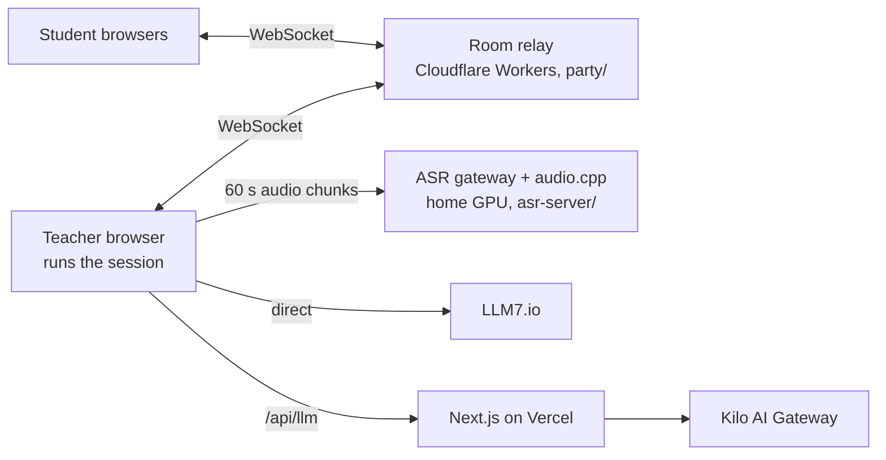

# Flowera

Flowera lets a teacher check, in real time, how well the class understands the lesson. Short questions go to every
student's phone or laptop during the lesson. The teacher writes the questions, or an LLM writes them from a live
transcript of the lesson, or both. Results are class-level only: no points, no rankings, no per-student statistics.

- **Teachers** pick a template, configure it, project a PIN/QR code, and run the lesson from a live dashboard.
- **Students** join with the PIN or QR code, optionally pick a name, and answer multiple-choice, true/false or number
  questions.
- **Privacy:** audio is never stored. The LLM never sees names. Exports and the report shared with students are
  anonymous. Everything else stays in the teacher's browser.

The full behavior is specified in [`docs/spec.md`](docs/spec.md); the build log is [`docs/plan.md`](docs/plan.md).

## Templates

| Template | What happens |
|---|---|
| **Hardcoded** | You write every question. They go out on a timeline (one every X minutes) or when you press Send. |
| **Automated** | The lesson is transcribed and an LLM writes questions from it: when it decides, at every interval, or on demand. Optional approval with editing. |
| **Worriless** | Nothing to configure: the LLM decides when and what to ask. |
| **Customized** | Your own questions on a timeline, plus LLM questions, with every setting exposed. |

## Architecture



| Part | Where | Code |
|---|---|---|
| Web app (teacher + student UI) | Vercel | `app/`, `components/`, `lib/` |
| Session engine (pure state machine) | Teacher's browser | [`lib/session/engine.ts`](lib/session/engine.ts) |
| Room relay | Cloudflare Workers + Durable Objects | [`party/`](party/README.md) |
| Transcription | Home PC, RX 9070 XT, VibeVoice-ASR via audio.cpp | [`asr-server/`](asr-server/README.md) |
| LLMs | Kilo AI Gateway (default) and LLM7.io: free, no API key | [`lib/llm/`](lib/llm) |
| Storage | `localStorage` only (no accounts, no database) | [`lib/storage.ts`](lib/storage.ts) |

If the GPU server is unreachable, the teacher's browser falls back to the Web Speech API (Chrome/Edge) and shows a
warning.

## Develop

Requires Node 22+.

```bash
npm install
cp .env.example .env.development.local     # then fill in ASR_TICKET_SECRET (see the file)

npm run party:dev      # room relay on 127.0.0.1:8799
npm run dev            # app on http://localhost:3000
# optional, for GPU transcription: see asr-server/README.md
```

To try it, open http://localhost:3000 for the teacher and http://localhost:3000/join in another browser profile (or
on your phone via your LAN IP) for students.

| Script | What |
|---|---|
| `npm run check` | Type-check app + worker, lint, unit tests. Run before committing. |
| `npm test` | Unit tests ([`tests/`](tests)): engine timing, queue, timeline, grading, anonymous exports, LLM JSON parsing |
| `npm run party:dev` / `party:deploy` | Run or deploy the room relay |
| `npm run asr:gateway` | Run the ASR gateway (needs `~/flowera-asr/gateway.env`) |

This project uses **Next.js 16**, which differs from older versions. See [`AGENTS.md`](AGENTS.md) and the bundled docs
in `node_modules/next/dist/docs/`.

## Deploy

See [`docs/deploy.md`](docs/deploy.md) for the step-by-step checklist (Cloudflare, Vercel, domain, home GPU).

## Where to change things

| To change… | Look at |
|---|---|
| Template names, colors, descriptions | [`lib/session/templates.ts`](lib/session/templates.ts) |
| Defaults (time limit, check interval, cooldown…) | [`lib/session/types.ts`](lib/session/types.ts) (`.default(...)` values) |
| How questions are timed, queued, graded | [`lib/session/engine.ts`](lib/session/engine.ts) (+ tests in `tests/engine.test.ts`) |
| LLM prompts | [`lib/llm/questions.ts`](lib/llm/questions.ts) |
| LLM providers / which models are offered | [`lib/llm/providers.ts`](lib/llm/providers.ts) |
| Student consent text | [`components/student/join-view.tsx`](components/student/join-view.tsx) (`ConsentStep`) |
| Chart colors | `--series-*` in [`app/globals.css`](app/globals.css) |
| Navigation tabs | [`components/nav/nav-tabs.tsx`](components/nav/nav-tabs.tsx) |
