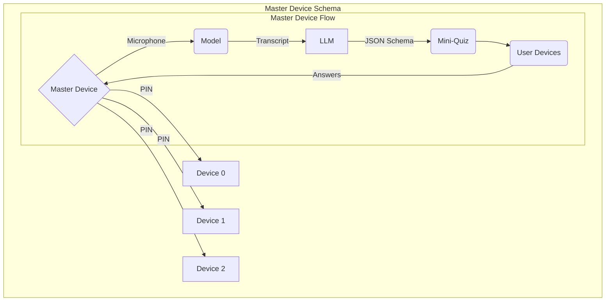

# [Title]

This application gives teachers direct access to each individual child's understanding via efficient mini-surveys applied on-demand (or automatically) to each student, minimizing disruptions while maximizing mutual understanding between the student-teacher dynamic.

# Setup

To begin, the teacher establishes a session from one of the pre-made templates (or configures a custom one). Regardless of templates, the feedback at the end is the same based on further configuration. The default templates include:

1. Hardcoded - The teacher manually picks questions and answers and picks when to trigger them. They may do this immediately after the initial menu. 

2. Automated - The teacher selects an interval or specifies to ask questions manually or both.

3. Worriless - The teacher does nothing; the LLM decides the when, what and how to ask questions.

4. Customized - The teacher gets to configure a custom template, which can include a custom mix of hardcoded and automated questions.

# Stack

We use TypeScript on Next.js with React, Tailwind and shadcn/ui. Both the master and user devices run in the browser.

We will also utilize PartyKit alongside Vercel alongside a custom domain to host it.

## Hardcoded

We use a basic layout builder for the teacher to configure exactly which questions get asked when/how. They may be triggered at arbitrary time intervals OR manually OR on other events.

## Automated

We use `VibeVoice-ASR-Streaming-1.5B-Q8_K` hosted online to form a transcript, taking the master device's microphone as input. The generated transcript is later processed at the set interval and fed into an LLM that decides whether to trigger a mini-quiz or not via structured JSON output.

## Worriless

Self-operating loop where the LLM decides whether to trigger a mini-quiz or not at certain intervals.

## Customized

We allow an in-depth mechanism for the teacher to pick between whether to use hardcoded questions or automated ones, with custom intervals or llm-decided ones.