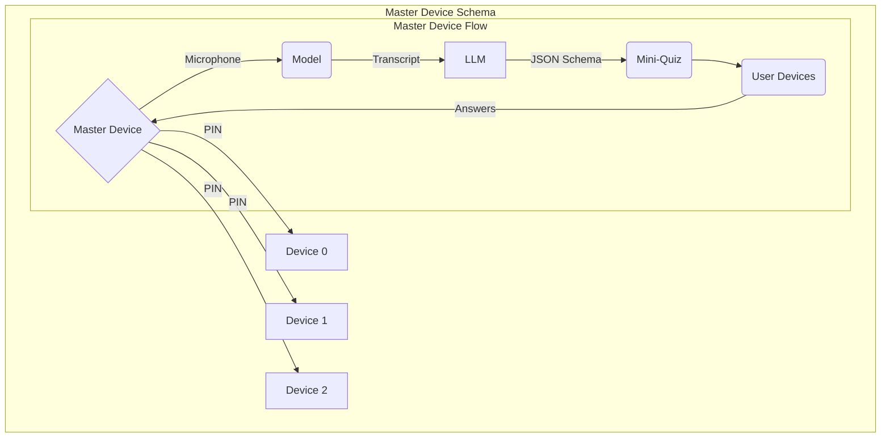

# [Title]

This application gives teachers direct access to each individual child's understanding via efficient mini-surveys applied on-demand (or automatically) to each student, minimizing disruptions while maximizing mutual understanding between the student-teacher dynamic.

# Setup

To begin, the teacher establishes a session from one of the pre-made templates (or configures a custom one). Regardless of input, a  The default templates include:

1. Hardcoded - The teacher manually picks questions and answers and picks when to trigger them. They may do this immediately after the initial menu. *

2. Automatic - The teacher selects an interval (eg 5 minutes) for which an LLM is asked based on transcripts whether to ask a question, if it decides so, it'll prompt all students and redirect all the data to the master device. This utilizes the master device's microphone.

# Stack

We use TypeScript on Next.JS with React, Tailwind and shadcn/ui. Both the master and user devices run in the browser.

We will also utilize Postgres and Supabase alongside Vercel alongside a custom domain to host it.

## Automatic

We use `VibeVoice-ASR-Streaming-1.5B-Q8_K` hosted online to form a transcript, taking the master device's microphone as input. The generated transcript is later processed at the set interval and fed into an LLM that decides whether to trigger a mini-quiz or not via structured JSON output.

