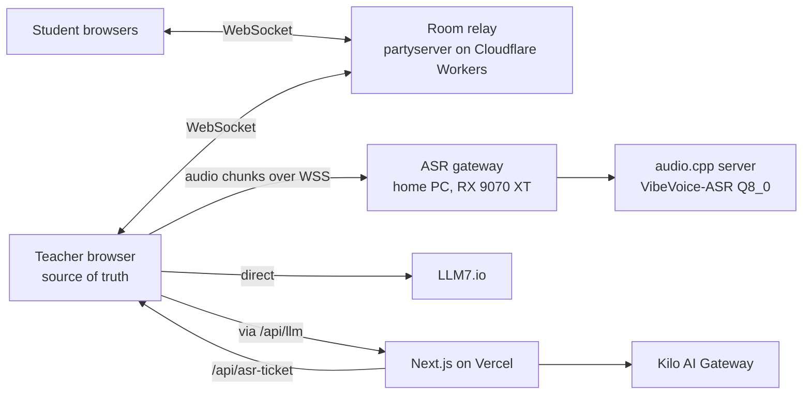

# Flowera — Specification

> Written 2026-11-01. This consolidates every decision made so far. Where it conflicts with older docs
> (`README.md`, `docs/setup_panels/*`, `docs/runtime/runtime.md`), **this file wins**.
> Items marked **[default]** are values I chose that you haven't confirmed yet; they're easy to change.
> The build order lives in [plan.md](plan.md).

---

## 1. Product

Flowera lets a teacher check, in real time, how well the class understands the lesson. It does this through short
anonymous-looking quizzes sent to every student's device during the lesson. The questions can be pre-written by the
teacher, generated by an LLM from a live transcript of the lesson, or both.

- **Users:** high-school teachers and students. All users are treated as 18+.
- **UI language:** English only.
- **Lesson languages:** Romanian and English. The transcription engine handles both, including switching mid-sentence.
- **Scale:** 20–30 students typical, 50 maximum per session.
- **Not Kahoot:** no points, no leaderboard, no per-student ranking or statistics, ever.

## 2. Architecture



| Piece | Where it runs | Job |
|---|---|---|
| Next.js app | Vercel, domain `floweratrustlens.tech` (reused) | All UI (teacher and student). A thin proxy for Kilo. Issues ASR tickets. |
| Room relay | Cloudflare Workers + Durable Objects (`partyserver`), free tier | One room per session PIN. Relays messages, tracks connections, keeps a snapshot so students survive teacher reloads. |
| ASR gateway | Home PC (this Fedora machine), port forwarding + Caddy TLS | Job queue in front of audio.cpp, ticket check, health endpoint. |
| LLMs | LLM7.io and Kilo AI Gateway | Free, **no key, no auth**. |
| Storage | Teacher's and students' `localStorage` | Configs, templates, live session, history. **No database, no login.** |

### Removed from the current code
Auth.js (`auth.ts`, `/api/auth`, the sign-in button), Drizzle/Postgres (`db/`, `drizzle.config.ts`, the Supabase `DATABASE_URL`),
`/api/models`, and the provider-settings and LLM-chat tables. Their dependencies come out of `package.json`. The current
`/api/llm` is rewritten to proxy **only** Kilo's fixed base URL, which also closes the SSRF hole in the old routes.
The navigation shell, theming and shadcn components stay. The doubled flex wrapper in `layout.tsx` gets fixed.

### Navigation tabs
Replaces the placeholder Providers/Evals/Results tabs:

| Tab | Route | Who |
|---|---|---|
| New session | `/` | Teacher: panels 0–2, then the lobby and the live session |
| Join | `/join` (QR links to `/join?pin=123456`) | Students |
| History | `/history` | Teacher |

Students see the same navigation bar.

## 3. Teacher setup flow

The current panel and every form value are saved to `localStorage`, so a refresh never loses work.

### Panel 0 — Welcome and template choice
- A short welcome and the four templates: **Hardcoded, Automated, Worriless, Customized**.
- **Design** (see `docs/setup_panels/panel_0/design.md` and `design.png`):
  - A background pattern of rhombuses, all the same size, on a skewed grid.
  - The four template tiles sit in a staircase: Hardcoded → Automated → Worriless → Customized. Automated borders
    Hardcoded and Worriless; Worriless borders Customized.
  - Each tile's own edges use its color: Hardcoded **red**, Automated **pink**, Worriless **purple**, Customized
    **blue**. The exact shades will be matched to `design.png`.
  - Each **shared edge** (green in the image) takes the color of whichever of its two tiles is hovered or selected
    (mouse hover or keyboard focus). If neither is, it shows a blend of the two tiles' colors.
  - Keyboard navigable (Tab and arrow keys). Mobile layout **[default]**: the same pattern scaled down, with tiles
    large enough to tap.

### Panel 1 — Template configuration (varies by template)

**Hardcoded**
- A question builder (Kahoot-like editor, see §5).
- A **timeline interval**: "one timeline question every X minutes", set once.
- Each question has an **"On timeline" toggle**:
  - **On:** the question fires automatically, in list order, at each timeline tick.
  - **Off:** the question is only fired by the teacher, in any order.
- Every question, on the timeline or not, can be fired manually at any time.
- No microphone and no LLM.

**Automated**
- LLM-generated questions only.
- **Trigger mode:**
  - **LLM decides:** at each check, the LLM chooses whether to ask.
  - **Interval:** a question is generated at every check.
  - **Manual:** a question is generated only when the teacher presses the button.
- **Ask me first** (approval) toggle, which applies to every LLM question. "Interval with consent" is Interval with
  this toggle on.
- **System prompt** field: lesson context (subject, topic, goals). Plain text, nothing else for now.

**Worriless**
- Panel 1 is skipped entirely.
- Fixed setup: LLM decides, no approval, built-in prompt.

**Customized**
- The question builder and timeline from Hardcoded, plus an **"Enable LLM questions"** switch.
- When the switch is on, the Automated options appear: trigger mode, approval toggle and system prompt.
- The system prompt field only shows when LLM questions are enabled.

### Panel 2 — Session settings
Shown for every template. For **Worriless** it has a big, vibrant **Continue** button so the teacher can accept the
defaults in one click.

**Questions** (defaults for every question; a question can override its own time limit):

| Setting | Default |
|---|---|
| Time limit | 60 s **[default]** |
| Students may change their answer until the question closes | on **[default]** |
| Show correct answers to students after a question closes | off **[default]** |

**AI** (only when the session uses the LLM):
- **Provider** dropdown: LLM7.io / Kilo AI Gateway, each with its logo.
- **Model** dropdown, with model-maker logos. Only models that work without a key are listed (see §8).
- **Check interval:** how often the LLM is consulted. 0 to the integer limit; default 5 min **[default]**.
- **Lesson language:** Romanian / English. This sets the language of generated questions and the Web Speech fallback.
  It lives here instead of panel 1 so Worriless has it too.

**Advanced** (collapsed):

| Setting | Default |
|---|---|
| Approval timeout | Wait indefinitely; or auto-approve / auto-reject after N s |
| LLM question cooldown (minimum time between two LLM questions) | 5 min, adjustable down to 0 |

Pressing **Start** creates the session and opens the lobby.

## 4. Live session (teacher)

### Lobby and projection
- A big **6-digit PIN** and **QR code** (`/join?pin=…`) for the teacher to project. Students join, then the teacher
  stops sharing their screen.
- The room is created when the session is created. Students can join at any time during the session.

### Main screen
- **Show answers** toggle, **off at session start** because the screen is probably projected.
  - **Off:** only counts are shown ("18/25 answered"); no names, no charts.
  - **On:** live charts, plus a list of who answered what. Names appear on the teacher's own screen only, never in
    exports.
- **Active question:** text, countdown, live pie chart.
- **Queue:** waiting questions; the teacher can reorder or remove them.
- **Question bank:** every pre-written question, each with a **Send** button.
- **AI status** (when the LLM is used):
  - next-check countdown;
  - microphone state;
  - transcription backend (GPU server or Web Speech fallback, the fallback shown as a **visible warning**);
  - a **Generate question now** button.
- **Approval card:** appears when an LLM question needs consent. The question is fully editable (text, options,
  correct answers) before approving. Buttons: Approve / Reject. Follows the approval-timeout setting.
- **Students panel:** each student's name and connection state (connected / reconnecting / left).
- **Event log** (see below).
- **Pause / Resume** and **End session** buttons.

### Event log
An accumulating, readable, color-coded list with a timestamp on every entry. Event types:

| Group | Events |
|---|---|
| Students | joined, left, disconnected, reconnected, renamed |
| Questions | sent, answer received, closed |
| LLM | check result (asked / declined / skipped, with the reason), approval asked / approved / rejected / timed out |
| System | microphone / ASR warnings and recovery, paused / resumed, report shared |

### Pause
- Triggered by the **Pause** button, or automatically when the teacher's tab disconnects or reloads.
- While paused, **everything freezes**: the active question's timer, the timeline, the LLM check interval and the
  cooldown. The **microphone is off**. Students see a "Paused" overlay.
- On resume, everything continues from where it froze. A teacher reload restores the session from `localStorage`
  together with the room snapshot.

### Statistics
- **Nothing is per student.** Every chart is a pie of what the class answered:
  - **Multiple choice:** one slice per distinct submitted combination of options **[default]**, because students can
    tick several options and per-option counts wouldn't add up to a whole.
  - **True/false:** True / False.
  - **Number:** In range / Below / Above.
  - Every pie also has a **Not answered** slice.
  - When answers are shown, slices that count as correct are highlighted.
- **Trends:** a line chart across the session's questions showing the share of correct answers and participation over
  time.
- **Optional LLM analysis at the end:** looks for broader trends. It receives **only anonymous aggregates** and the
  question texts; never names, never the transcript.

## 5. Questions

| Type | Teacher defines | Student does | Counts as correct when |
|---|---|---|---|
| Multiple choice | Text, 2–8 options **[default]**, **one or more** correct options | Ticks any number of options, then presses Submit (even if only one is correct) | The ticked set equals the correct set exactly **[default]** |
| True/false | Statement, the correct value | Picks True or False | It matches |
| Number | Text; an optional **input limit** [min, max] that restricts what can be typed; a **correct range** [lo, hi] (lo = hi means an exact value) | Types a number | It falls within [lo, hi] |

Every question also has an optional time-limit override. The LLM produces the same three types, including which
answers are correct.

## 6. Triggers and the queue

- **One active question at a time.** Everything else waits in a FIFO queue that the teacher can reorder.
- **Sources:**
  - **Manual:** the teacher sends a bank question.
  - **Timeline:** every X minutes since the session started, not counting paused time, the next "On timeline"
    question, in order.
  - **LLM:** see below.
- **When a question closes:** when its time runs out, or early if every connected student has answered **[default]**.
  Anyone who didn't answer is recorded as **Not answered**.
- **LLM checks:**
  1. Run every *check interval* (paused time excluded). A timed or manual question does **not** reset this schedule.
  2. **Skip rule:** if a manual or timeline question went out since the last completed check, the check is skipped
     without calling the LLM, and the transcript keeps accumulating into the next check.
  3. Otherwise the LLM receives:
     - the system prompt;
     - the transcript **since the last completed check** (the first check gets everything so far);
     - the list of questions already asked, so it doesn't repeat itself.
  4. The LLM replies with JSON in this shape:

     ```json
     { "ask": true, "reason": "…", "question": { "type": "multiple_choice", "text": "…", "options": ["…"], "correct": [1] } }
     ```

     In **Interval** mode `ask` is forced to true. In **Manual** mode a check runs only when the teacher presses the
     button.
  5. If the cooldown since the last LLM question hasn't passed, the question is dropped and logged.
  6. If approval is on, the approval card appears. Then the question joins the queue.

## 7. Student experience

- **Join:** enter the PIN or scan the QR code.
- **Consent screen** (first join on a device): explains what the teacher sees (name if given, and answers), that
  exports and shared reports are anonymous, and that the lesson audio is transcribed and never stored.
- **Name:** optional. A placeholder like "Blue Fox" **[default]** is pre-filled, so students can skip straight in.
  They can rename later; renames are logged.
- **Reconnects:** a client ID in `localStorage` brings a student back as the same person after a reload or dropped
  connection, without asking again. A **Leave** button quits explicitly, and that's logged.
- **Idle:** a minimal waiting screen. The client is a "dumb answering machine" that does nothing until a question
  arrives.
- **History:** students can view their own answers for this session, stored on their device only.
- **Late joiners** get the question in progress if it's still open, but no earlier ones.
- **After a question:**
  - "Submitted" confirmation; the answer can be changed while the question is open, if allowed.
  - Correct answers are revealed only if the teacher enabled it.
- **Shared report:** students get nothing at the end unless the teacher presses **Share report**. That sends every
  client the full anonymous report: every question, the class's answer distribution, and the correct answers.

## 8. LLM providers

Both are OpenAI-compatible, free, and need **no API key**. Checked live on 2026-11-01:

| | LLM7.io | Kilo AI Gateway |
|---|---|---|
| Base URL | `https://api.llm7.io/v1` | `https://api.kilo.ai/api/gateway` |
| Keyless models | `tier !== "pro"` in `/models`. Currently `gpt-oss:20b`, `mistral-Nemo-Instruct-2407`, `codestral-latest`, `nemotron-3-nano:30b` | IDs containing `:free`, plus `kilo-auto/free` and `openrouter/free` |
| Rate limit | About 30 requests/min per IP (third-party figure, not confirmed) | 200 requests/hour per IP (official) |
| Browser CORS | Allowed: called **directly from the teacher's browser** | Not allowed: called **via `/api/llm`** on Vercel. All Kilo users then share Vercel's IP quota, roughly 15 simultaneous classes at one check per 5 minutes. |

- Model lists are fetched live and filtered to the keyless models above.
- Most free models are reasoning models. Requests set a generous `max_tokens`. The reply is parsed tolerantly (strip
  code fences, extract the first JSON object), validated with zod, and retried once on failure.
- **UI:**
  - Provider dropdown: the trustlens `Select` + `ProviderLabel` pattern.
  - Model picker: the trustlens `Combobox` with `pics_corpos` / `getPic` maker icons. Icons are copied from
    `trustlens/public/icons`.
  - LLM7 and Kilo have no icons in trustlens yet; I'll add their logos, falling back to `llm.svg`.

## 9. Transcription (ASR)

### Main engine: VibeVoice-ASR on the home PC
- **Model:** `microsoft/VibeVoice-ASR`, the non-streaming version.
  - It lists Romanian among its 50+ languages and handles code-switching.
  - It labels speakers (diarization) and gives timestamps, which help the LLM tell the teacher apart from students.
  - The **streaming** 1.5B model **doesn't support Romanian**, so it's out.
- **Runtime:** [audio.cpp](https://github.com/0xShug0/audio.cpp)'s `audiocpp_server`, built with **HIP/ROCm**
  (Vulkan as the backup), loading `cstr/vibevoice-asr-GGUF` → `vibevoice-asr-q8_0.gguf` (9.45 GB).
  - That's **one instance** in 16 GB of VRAM; the number of workers is configurable anyway.
- **Batching, not streaming:** the teacher's browser records 16 kHz mono PCM, keeps it **in memory only**, and sends
  it in chunks of about 60 s **[default]**.
  - Latency doesn't matter much, because transcripts are only read at checks that are minutes apart.
  - Longer chunks keep speaker labels more consistent.
- **ASR gateway** (new service, TypeScript/Node, in `asr-server/`):
  - accepts audio chunks over WSS;
  - checks a short-lived **HMAC ticket** issued by the Vercel route `/api/asr-ticket`, so strangers can't use the GPU
    (teachers never see a key);
  - queues jobs FIFO for the audio.cpp server;
  - returns text with speaker labels;
  - exposes `/health` with status and queue length.
- **Exposure:**
  - router **port forwarding** to the PC;
  - a hostname such as `asr.floweratrustlens.tech` pointing at the home IP, with dynamic DNS if the IP changes;
  - **Caddy** in front for automatic Let's Encrypt TLS. This is required: an HTTPS page can't open `ws://`.
  - Check for CGNAT: the router's WAN IP must match the public IP.
- **Availability:** the PC only needs to be on when the app is used, for example the demo.
- **Never stored:** audio is never written to disk anywhere, including the gateway and audio.cpp; Phase 0 verifies
  this. Transcripts live only in memory for the current check window and are **not** saved to history **[default]**.

### Fallback: Web Speech API
- Used **only** when the GPU server is unreachable or its queue is full.
- Shown as a visible warning. The app retries the server periodically and switches back when it recovers.
- Limitations:
  - Chrome and Edge only.
  - Audio goes to Google's or Microsoft's servers.
  - No speaker labels.
  - Picks up students poorly from across the room.
  - Romanian quality is unmeasured.

## 10. History, export and import

- Ended sessions are saved to the teacher's `localStorage`: config, questions, every answer **including names**
  (teacher's device only), and the log.
- The History page lets the teacher view, delete, export and import sessions.
- **Exports never contain names:**
  - **JSON:** the full session, anonymized; re-importable.
  - **CSV:** one row per question, with type, text, correct answer, a count per answer and the not-answered count.
- Imported sessions are anonymous, because the export had no names.

## 11. Realtime protocol (outline)

- **Room:** one per session, keyed by PIN.
- **Teacher identity:** the teacher holds a random **host token** created with the session and stored in
  `localStorage`. Only messages carrying that token are accepted as teacher messages.
- **Student identity:** students send their client ID and name.
- **Teacher → students:** `question.open`, `question.close` (with the reveal if enabled), `session.pause`,
  `session.resume`, `session.end`, `report.share`.
- **Students → teacher:** `hello`, `answer`, `rename`, `leave`.
- **Room → teacher:** `presence` (connect / disconnect).
- **Room snapshot:** the room keeps the session state, the open question and received answers. That way students
  reconnect correctly and the teacher can resync after a reload. The teacher's browser stays the decision-maker.
- **Local development:** `wrangler dev`. Deploying needs a free Cloudflare account and one `wrangler deploy`.

## 12. Privacy

- Audio is never stored.
- The LLM never sees names.
- Exports and shared reports are anonymous.
- Names exist only on the teacher's device and in the live room's memory.
- A consent screen for students; a microphone notice for the teacher before recording starts.

## 13. Out of scope (for now)
Accounts, a database, points or leaderboards, per-student statistics, questions targeted at individual students,
event-based triggers ("other events" was dropped), app UI translations, and sync across the teacher's devices.
